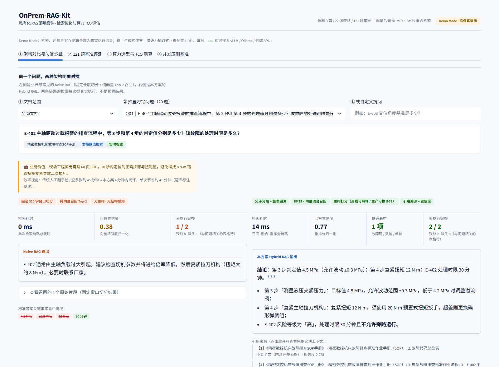
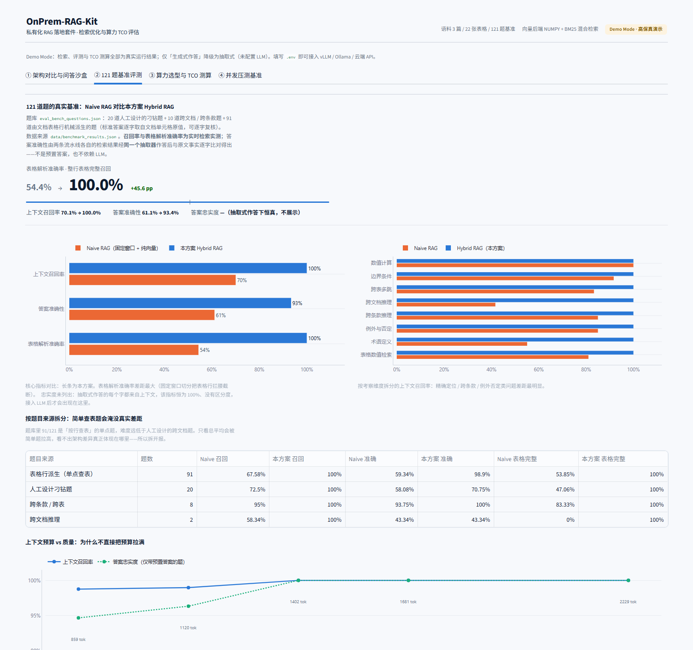
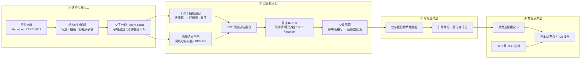
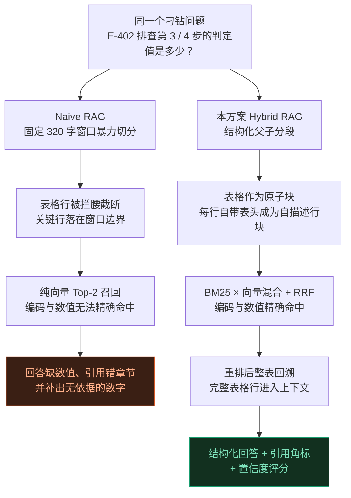
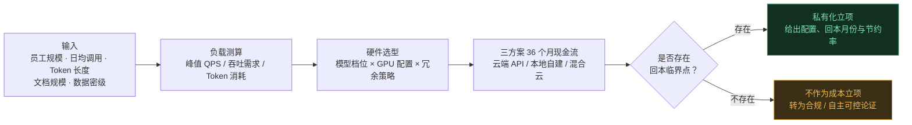

<div align="center">

# OnPrem-RAG-Kit

### 私有化 RAG 落地套件 · 检索优化与算力 TCO 评估

**把「企业文档检索答不准」和「私有化算力到底该不该买」两个问题，做成一套可复现、可验证、能直接拿去立项的开源工具。**


</div>

---

## 📌 一分钟速览

| 维度 | 传统 Naive RAG | 本方案 Hybrid RAG | 数据性质 | 结论 |
| :-- | :--: | :--: | :--: | :-- |
| **表格解析准确率** | 54.4% | **100.0%** | 实时实测 | 固定长度切分把表格行拦腰截断，这是工程文档失分的头号原因 |
| **上下文召回率** | 70.1% | **100.0%** | 实时实测 | 关键事实逐字命中；编码 / 数值 / 条款号漏召回则回答必然残缺 |
| **答案准确性** | 61.1% | **93.4%** | 实时实测（抽取式作答） | 两条流水线用同一抽取器各自作答后逐字比对，非预置答案 |
| **私有化三年成本**（3000 人规模） | 云端 API ¥158.9 万 | **本地自建 ¥117.0 万** | 财务模型 | 节约 **26.3%**，回本临界点 **第 17.1 个月** |
| **并发 50 时推理吞吐** | Ollama 165 tokens/s | **vLLM 1,680 tokens/s** | 行业公开基准 | **10.2×**，首字延迟仅 **1/28.5** |

> 上表为 **121 道题**的全量结果（20 道人工刁钻题 + 10 道跨文档题 + 91 道由文档表格行机械派生、
> 标准答案逐字取自单元格原值的题）。题库生成脚本 `scripts/generate_eval_set.py` 可复跑。
>
> **⚠️ 口径必须分开看**：召回率与表格准确率是每次运行都真实执行的检索实测；
> 答案准确性由两条流水线各自的检索结果经**同一个抽取器**作答后与原文事实比对得出——
> 是真跑出来的，不是预置答案，但它是 **LLM 作答准确率的下界**：抽取器一次只摘 6 行、
> 不会跨行推理，需要汇总多行的题它会失分。
>
> **答案忠实度在本口径下不展示**：抽取式回答的每个字都来自上下文，该指标恒为 100%、
> 没有区分度。把它当结论展示等于用恒真指标给弱系统背书。接入 LLM 后它才重新出现。
>
> **简单题会淹没真实差距**，所以按题目来源拆开报——见 §4.2。

上述每一个数字都可以在本机复现：`python scripts/smoke_test.py` + 打开看板点「重新运行实测评测」。

---

## 🎬 界面与演示视频





> **[▶ 播放完整演示视频 demo_tour.mp4](demo_tour.mp4)**　四屏联动走查，约 82 秒

视频依次走过：**Tab 1** 同一个刁钻问题下两种架构同屏对撞（Naive RAG 召回被截断的表格碎片，本方案整表回溯 + 引用角标 + 置信度）→ **Tab 2** 121 题基准看板（按来源拆分、逐题召回率分布、上下文预算曲线与逐题明细）→ **Tab 3** 算力选型与 TCO（拖动规模参数，实时算出硬件配置、36 个月成本曲线与回本临界点）→ **Tab 4** vLLM 与 Ollama 并发压测。

界面截图由 `python scripts/ui_shot.py` 输出（无损 PNG + 关键元素计算样式回读，可作视觉回归基线）；演示视频由 `python scripts/record_demo.py` 生成（Playwright 驱动真实 Chromium 录屏，字幕在页面内注入，无后期合成）。两者均可随时重跑。

---

## 一、商业痛点：为什么企业「上了 AI」还是不好用

做过十几个私有化项目后会发现，企业知识库失败几乎从不是「模型不够聪明」，而是两件事没人管：

**痛点 A · 检索层：文档是给人看的，不是给切片器看的**

- **金融**：一份 80 页的制度文件，审批权限写在一张跨页表格的第 7 行。固定长度切分把那一行切成了两半，模型拿到的是「$280 万元需经分管副总」和「裁审批」两条残片，于是凭空补了一个「总经理审批」——**合规风险直接落到审计报告上**。
- **制造**：设备手册里 `E-402` 的处理时限是 30 分钟、`E-603` 是 2 小时。纯向量检索对「E-402」这类故障码几乎没有区分力，召回的是语义相近但完全无关的另一段，现场工程师照着重置，**故障停机从 15 分钟拖成 2 小时**。
- **建筑**：违约金比例按合同金额分四档。向量检索把「1800 万元」映射到「合同金额较大」的语义邻域，却算不出它落在「1500–3000 万」这一档的 `0.4‰`，**结算谈判时多付十几万**。

**痛点 B · 决策层：技术方案讲得再好，CFO 只问三个问题**

1. 要花多少钱？—— 不是硬件报价，是三年总拥有成本。
2. 什么时候回本？—— 给我一个月份，不是「长期看更划算」。
3. 数据安全达标吗？—— 密级决定架构，架构决定成本。

**本套件就是为回答这两类问题而生的。** 它不只是一个 RAG Demo，而是「检索工程质量」+「算力财务模型」的合体：左边证明答得准，右边证明买得对。

---

## 二、系统架构



**四层职责**：结构化接入层负责「别把文档切坏」，混合检索层负责「该找到的一定找得到」，可信生成层负责「说得有据可查」，商业决策层负责「值不值得买」。

---

## 三、Advanced RAG 工程实现

### 3.1 对照组是怎么失败的



### 3.2 五个关键设计

**① 表格原子块：解析阶段就把表格锁死。** 解析器识别 Markdown 表格后将其视为不可切分单元，任何字符级窗口都不允许跨越表格边界。实测 3 篇文档共 22 张表格，对照组固定窗口下有 **24 行表格被截断**，本方案为 **0 行**。

**② 表格行自描述化。** 每个表格行切片都会带上表头一起入库，因此单独一行也能读懂：

```
| 步骤 | 排查项目 | 判定标准 / 目标值 | 使用工具 | 处置动作 |
| 3 | 测量液压夹紧压力 | 目标值 4.5 MPa，允许波动范围 ±0.3 MPa | 0-10 MPa 精密压力表 | 低于 4.2 MPa 时调整溢流阀 |
```

**③ 父子分段 + 整表回溯。** 子块（细粒度）用于召回，父块（完整小节 / 整张表）用于喂给 LLM。命中任意一行表格，都回溯出**整张表**——这直接决定了「表格解析准确率」。

**④ BM25 × 向量混合 + RRF 融合。** 中文场景采用「字符 bigram + 编码保留」的分词策略，`E-402`、`0.4‰`、`12 N·m`、`HX-40×10Q` 这类硬 token 会被原样切出并加权。融合用 RRF（Reciprocal Rank Fusion, k=60），再对命中硬 token 的候选做增强。

**⑤ 领域自适应重排。** 重排打分 = 硬 token 命中(0.38) + 词法覆盖(0.24) + 语义相似(0.18) + BM25(0.12) + 结构先验(0.08)。权重可解释、可调，接入 `BAAI/bge-reranker-v2-m3` 后同一接口直接换成模型打分。

---

## 四、评测结果：121 题规模化基准集

上一版只有 20 道题，修好检索后全部满分——**满分不是成绩，是题库饱和的信号**。
本版把题库扩到 121 道，其中 91 道是**机械派生**的，标准答案不经过人手：

| 题目来源 | 题数 | 怎么来的 | 可复核性 |
| :-- | :--: | :-- | :-- |
| 人工设计刁钻题 | 20 | 跨文档、例外否定、数值计算 | 题库中逐条列出 gold_evidence |
| 跨文档 / 跨条款 | 10 | 两篇制度互相引用的条款（如各自第 1.3 条） | 证据逐字摘自原文 |
| **表格行派生** | **91** | 题目文本由「表头 + 行键」拼成，答案逐字取自单元格原值 | `gold_row` 为该行原文整行；脚本 `scripts/generate_eval_set.py` 可复跑 |

派生题的生成有两条硬规则，都写在脚本里可复核：**题目文本不含答案原文**（否则检索被题目喂答案）；
**只对有区分度的值出题**（某个值若在语料里反复出现，"错误片段"也能命中，这类列自动跳过）。

### 4.1 全量结果（121 题）

| 评测指标 | Naive RAG | **本方案 Hybrid RAG** | 提升 | 数据性质 |
| :-- | :--: | :--: | :--: | :--: |
| 上下文召回率 Context Recall | 70.1% | **100.0%** | +29.9 pp | 实时实测 |
| **表格解析准确率 Table Accuracy** | **54.4%** | **100.0%** | **+45.6 pp** | 实时实测 |
| 答案准确性 Answer Accuracy | 61.1% | **93.4%** | +32.3 pp | 实时实测（抽取式作答） |
| 答案忠实度 Faithfulness | — | — | — | 该口径下恒真，不展示 |

### 4.2 按题目来源拆分：简单题会淹没真实差距

91/121 是「按行查表」的单点题，本方案在这类题上达 98.9%；真正体现架构差异的是人工题。
只看总平均会得出「差距没那么大」的错误印象，所以拆开报：

| 题目来源 | 题数 | 召回(N) | 召回(本) | 准确(N) | 准确(本) | 表格完整(N) | 表格完整(本) |
| :-- | :--: | :--: | :--: | :--: | :--: | :--: | :--: |
| 表格行派生（单点查表） | 91 | 67.6% | **100%** | 59.3% | **98.9%** | 53.8% | **100%** |
| 人工设计刁钻题 | 20 | 72.5% | **100%** | 58.1% | **70.8%** | 47.1% | **100%** |
| 跨条款 / 跨表 | 8 | 95.0% | **100%** | 93.8% | **100%** | 83.3% | **100%** |
| 跨文档推理 | 2 | 58.3% | **100%** | 43.3% | 43.3% | 0.0% | **100%** |

两处值得单独说：

- **人工刁钻题的准确率只有 70.8%**，远低于单点查表题的 98.9%。原因不是检索——召回是 100%——
  而是抽取器一次只摘 6 行、不会跨行汇总。这正是「抽取式作答是下界」的具体体现。
- **跨文档推理的准确率两侧都是 43.3%**：检索已经找全了证据（100%），但抽取器不会把两份文档的
  结论拼起来。这是一个诚实的负结果，不藏。

### 4.3 按考察维度拆分（上下文召回率）

| 维度 | 题数 | Naive RAG | 本方案 | 说明 |
| :-- | :--: | :--: | :--: | :-- |
| 表格数值检索 | 50 | 81.0% | **100%** | 整表回溯直接生效：命中任意一行即还原整张表 |
| 术语定义 | 49 | 55.1% | **100%** | 附录术语表被固定窗口切碎，纯向量几乎无法命中 |
| 例外与否定 | 6 | 85.0% | **100%** | 「哪些不允许」类问题最考验召回完整性 |
| 跨条款推理 | 5 | 85.0% | **100%** | 需同时命中两个章节并做逻辑串联 |
| **跨文档推理** | **4** | **41.7%** | **100%** | 曾是最弱项，修复候选池后补齐（见 §4.8） |
| 跨表多跳 | 3 | 83.3% | **100%** | 答案分散在不同表格，且分档区间互不相同 |
| 边界条件 | 3 | 91.7% | **100%** | 「恰好 50 万元适用哪一档」 |
| 数值计算 | 1 | 100.0% | **100%** | 选档 + 计算，双方都能召回原始数据 |

### 📐 评测口径与局限性（必读）

我们刻意把口径写清楚，因为**一个不敢披露口径的评测没有说服力**：

#### 4.4 三类指标的可信度并不相同

| 指标 | 怎么来的 | 能说明什么 | 不能说明什么 |
| :-- | :-- | :-- | :-- |
| 上下文召回率 | 每题实时检索，逐字比对原文证据串 | 检索链路是否把证据找回来了 | 回答得好不好 |
| 表格解析准确率 | 同上，检查整行表格是否原样出现在上下文 | 结构感知解析 + 整表回溯是否生效 | — |
| 答案准确性 | 两条流水线各自的检索结果 → **同一个抽取器**作答 → 与原文事实逐字比对 | 答案能不能从检索结果里摘出来 | LLM 的生成能力（这是下界） |
| ~~答案忠实度~~ | 抽取式回答的每个字都来自上下文，按定义不可能出现无依据断言 | — | 该口径下恒为 100%，**没有区分度** |

**为什么答案准确性这次算"真实"了**：上一版是对题库预置的专家答案打分，标准答案和参考答案
由同一人写在同一份题库里，属自证。本版两条流水线用**同一个确定性抽取器**，各自从自己召回的
上下文里挑原文行拼成回答——检索不同则上下文不同、抽出来的答案就不同。分数是跑出来的。

#### 4.5 忠实度为什么不展示，以及它什么时候回来

抽取式作答下，忠实度对两条流水线都恒为 100%。**把一个恒真指标当结论展示，等于用满分给弱系统背书**，
比不报这个指标更糟。所以 `benchmark_results.json` 里该字段直接是 `null`，界面显示「—」。

它不是被删了，是**换口径才生效**：

```bash
python -m core.evaluator --answer-mode generated --write   # 需先在 .env 配置 LLM
```

此时检索照常实时执行，回答侧改为实时调用 LLM 生成，同一套打分器立刻恢复对无依据断言的检测
（数值做了等价归一：`252,000 元` 与 `25.2 万元` 视为同一事实，避免把正确计算误判成幻觉）。

#### 4.6 上下文预算：一条质量 / 成本曲线，而不是一个漂亮数字

默认预算取 **5 个父块**，规则是「**达成满召回的最小预算**」——由曲线决定，不是拍脑袋。

| 上下文块数 | 上下文召回率 | 平均上下文 token |
| :--: | :--: | --: |
| 3 | 98.8% | 859 |
| 4 | 99.0% | 1,120 |
| **5（默认）** | **100.0%** | **1,402** |
| 6 | 100.0% | 1,681 |
| 8 | 100.0% | 2,229 |

这条曲线可以直接在看板 Tab 2 里看到。它说明的是：**3 块省 39% token 但漏 1.2pp 召回**，
把预算拉到 8 只是白花 59% 的 token。选 5 是权衡结果，不是把参数调到分数最好看。

（看板上还有一条忠实度曲线，但只覆盖题库中 20 道带预置答案的题，与主表口径不同，仅作趋势参考。）

#### 4.7 对照组并不弱，但小语料会掩盖差距

Naive RAG 用的是 320 字固定窗口 + 纯向量 Top-2。在只有 3 篇文档的小语料上，
Top-2 固定窗口本身就覆盖了 5% 的语料，**70.1% 的召回率并不难看**。
真实企业知识库动辄数千切片，Top-2 的覆盖率会掉到 1% 以下，差距只会更大。
**真实语料上不应期待本套件的 100%**，工程经验值约为 85–95%。

#### 4.8 上一版的 97.5% 是怎么来的（一次归因错误）

上一版把缺口归因为「Top-4 上下文窗口不够」，这个归因是**错的**。
实测把上下文数从 4 加到 32，Q18 依然是 50%。真正的瓶颈是**重排候选池**：

```
top_k_children=8   → 候选来源 {construction_spec: 8}          # 单文档垄断
top_k_children=20  → 候选来源 {construction_spec: 14, cnc_sop: 1, procurement_policy: 5}
```

候选池写死 8 条时，重排器只能在 8 条里排序，另外两篇文档的证据**根本进不了视野**。
重排无法召回池外内容——这是结构性缺陷，不是预算问题。本版修复了三处：

1. **候选池随语料自适应**：`max(12, 3√n)`（132 个切片 → 36 条候选）；
2. **文档多样性配额**：第一轮每篇文档最多占一半槽位，第二轮放开填满，避免单文档垄断；
3. **包含关系去重**：整表既作为独立表格父块、又被并入小节父块，旧实现会把同一张表占用两个槽位；
   现在若新上下文被已选上下文包含则跳过，反之则原地升级为更完整的那份。

顺带修掉一个更隐蔽的 bug：重排器原来在**候选池内做 min-max 归一化**，池子从 8 条扩到 36 条时，
所有分数被重新缩放、排序随之漂移，扩池本意是改善召回，却把 Q07 的正确答案挤了出去。
现已改为与池大小无关的绝对量（余弦直接取值、BM25 用 `bm/(bm+8)` 饱和变换）。

---

## 五、私有化算力选型与 TCO / ROI 测算

### 5.1 决策模型



**这个「否」分支是本套件最重要的设计。** 一个只会说「私有化更省」的测算器是销售工具，不是决策工具。

### 5.2 三场景实测结果

| 场景 | 业务规模 | 云端 API 月成本 | 本地一次性投入 | 三年 API | 三年本地 | 三年节约 | 回本临界点 | 推荐配置 |
| :-- | :-- | --: | --: | --: | --: | :--: | :--: | :-- |
| 轻量型（合规驱动） | 800 人 × 3 次/日 × 3K tokens | ¥5,417 | ¥36.1 万 | 18.0 万 | 97.0 万 | **不占优** | 36 个月内未回本 | RTX 4090 × 2 |
| **平衡型（推荐）** | 3,000 人 × 5 次/日 × 4K tokens | ¥45,144 | ¥41.6 万 | **158.9 万** | **117.0 万** | **26.3%** | **第 17.1 个月** | RTX 4090 × 4 |
| 规模化（强推荐） | 5,000 人 × 8 次/日 × 5K tokens | ¥140,800 | ¥65.1 万 | 586.7 万 | 149.6 万 | **74.5%** | **第 5.5 个月** | RTX 4090 × 8 |

> 云端对照统一取企业级旗舰模型档位（GPT-4o 级，¥18 / ¥72 每百万 token）。**换用高性价比模型会彻底改变结论**——测算式内置 7 档云端模型与逐档敏感性分析，就是为了让评审会上第一个问题「你拿什么价对比」有现成答案。

### 5.3 成本模型都算了什么（诚实披露）

自建的成本**从来不只是显卡**。本模型计入：

| 成本项 | 计入方式 |
| :-- | :-- |
| 硬件 + 整机平台 | 按 GPU 型号与卡数实时选型，支持采购折扣 |
| 存储 / 网络 / 备件 | NVMe + 备份 + 万兆交换 + 5% 备件计提 |
| **一次性实施费** | 知识库工程（按文档 GB 计）、系统集成、部署压测、**安全合规加固**（按密级）、培训交付 |
| 电费 | 功率 × 24 × 30.4 × **PUE 1.45** × 工业电价 |
| 机房托管 | 按机柜数计 |
| **运维人力** | 默认 0.5 FTE × 18 万/年 —— 这一项常被忽略，却是隐性成本大头 |
| 模型迭代与评测 | 版本更新、回归测试、提示词调优 |
| 硬件维保 | 按硬件成本的 3%/年 |

同时模型**不假设对自己有利的趋势**：云端 API 单价按年下降（默认 15%），业务量按年增长（默认 15%），两者部分抵消；冗余策略（无冗余 / 冷备 / 双机热备）会显著改变 CAPEX，热备的备机 GPU 功耗也已计入电费。

**效率收益（影子价值）单独处理，且刻意不给"收益率"。** 节省的工时按「人均每日检索工时上限」封顶、按 12 个月采纳爬坡计入，并按价值实现率（默认 50%）折算，**不混入**基础设施成本对比。

为什么不给收益率？因为人力单价假设会把 ROI 推到四位数（曾出现 3155%），那种数字只会让评审失去判断力，也不构成任何决策依据——它完全由「人均节省时长 × 价值实现率」两项假设决定，与架构选型无关。界面改为展示**三年净收益（万元）**，并明确标注"口径高度敏感，仅供内部沟通"。要拿它立项，先做小范围 A/B 实测替换默认值。

### 5.4 一个反直觉但重要的结论

**在 800 人规模、日均 3 次调用的场景下，自建在三年内比云端 API 贵 4 倍以上。** 这不是模型的缺陷，而是 2025–2026 年的真实市场事实：主流闭源 API 的单次问答成本已低至 ¥0.007–0.15 量级，而一套本地私有化的固定成本（硬件 + 实施 + 运维）每月约 ¥1.6–2.7 万打底。

**因此本项目给出的是决策树，不是销售话术：**

- 规模不足 + 密级不高 → **继续用 API**，把预算投在数据治理上；
- 机密级及以上 / 峰值并发不可控 / 需要微调与自主可控 → **私有化立项，但不要用省钱当理由**；
- 规模达到数千人且调用密度高 → **私有化是明确的经济选择**，回本周期可压缩到半年内。

---

## 六、vLLM vs Ollama 并发压测基准

> **数据来源声明**：下表为**行业公开基准参考值**——依据 vLLM / Ollama 社区公开压测报告与同型号硬件的公开实测区间整理，**不是本机实测结果**，仅用于演示图表与容量规划参考。正式立项前必须在目标硬件上按相同负载重新压测后替换 `data/benchmark_results.json` 的 `perf` 字段。

**参考环境**：2 × NVIDIA RTX 4090 24GB（PCIe 5.0 ×8/×8）· Qwen2.5-32B-Instruct-AWQ（4-bit，TP=2）· prompt 512 / output 256 tokens · 连续压测 10 分钟取稳态值

| 并发 | vLLM TTFT | Ollama TTFT | vLLM 吞吐 | Ollama 吞吐 | vLLM 端到端 | Ollama 端到端 |
| :--: | --: | --: | --: | --: | --: | --: |
| 1 | 182 ms | 328 ms | 46.5 t/s | 41.2 t/s | 5.7 s | 6.5 s |
| 5 | 205 ms | 1,860 ms | 210.4 t/s | 120.0 t/s | 6.3 s | 12.5 s |
| 10 | 248 ms | 4,260 ms | 410.8 t/s | 135.0 t/s | 6.5 s | 19.4 s |
| 20 | 372 ms | 9,750 ms | 780.0 t/s | 156.0 t/s | 6.9 s | 32.8 s |
| **50** | **940 ms** | **26,800 ms** | **1,680 t/s** | **165 t/s** | **8.6 s** | **77.6 s** |

**结论**：Ollama 的 4 路并行在约 165 tokens/s 处饱和（≈ 4 × 单请求吞吐 41 t/s），并发超过 4 之后新请求只能在服务端排队，因此首字延迟随并发线性劣化——并发 50 时劣化到 26.8 秒。vLLM 依靠 PagedAttention + Continuous Batching，吞吐随并发近似线性扩展到 **10.2 倍**，TTFT 仍压在 1 秒内。

> **口径自检**：`OLLAMA_NUM_PARALLEL=4` 与表中"吞吐饱和在 4 倍单请求水平"是自洽的；若标注为 1，则吞吐应停在 41 t/s 附近。这类"配置标注与数据对不上"是压测表格最常见的硬伤，本表已核对。

**工程建议**：本地开发、单用户验证用 Ollama 足够（部署简单、无需显存规划）；一旦进入多部门并发（OA 嵌入、工单系统、多部门同时使用），**必须切换到 vLLM**，否则 10 并发以上就会出现数十秒的排队首字延迟。

---

## 七、快速开始

### 7.1 三步跑起来（零配置，无需 API Key，无需 GPU）

```bash
git clone https://github.com/tiewangba2020/OnPrem-RAG-Kit.git
cd OnPrem-RAG-Kit
```

```bash
pip install -r requirements.txt
```

```bash
streamlit run app.py
```

浏览器打开 `http://localhost:8501`。首次运行会自动生成 3 篇行业样例文档、121 题评测基准与压测数据。

### 7.2 一键自检（交付前 / CI 均可跑）

```bash
python scripts/smoke_test.py
```

该脚本会用 Streamlit 官方 `AppTest` **在进程内完整执行 app.py**——四个 Tab 的渲染代码全部真实运行，任何异常都会暴露，同时校验解析、检索、评测、TCO 四条链路。

### 7.3 接入真实模型

```bash
cp .env.example .env
```

配置好之后，**评测要显式切换作答模式**，否则默认仍是抽取式作答（真实抽取，但不会跨行推理）：

```bash
python -m core.evaluator --answer-mode generated --write    # 实时生成回答并评分
python -m core.evaluator --write                # 只重跑检索实测，回答侧仍用预置样例
```

`.env` 支持三种接入形态：

| 形态 | 配置 | 适用 |
| :-- | :-- | :-- |
| **本地 Ollama** | `LLM_PROVIDER=ollama` | 开发验证、单用户 |
| **本地 vLLM**（OpenAI 兼容） | `LLM_PROVIDER=vllm` + `LLM_BASE_URL` | 生产环境部署 |
| **云端 API** | `LLM_PROVIDER=deepseek\|qwen\|openai` + `LLM_API_KEY` | 快速验证 / 非敏感场景 |

同时可切换 `EMBEDDING_PROVIDER=api`（BGE-M3 等）与 `RERANKER_PROVIDER=bge`（BGE-Reranker-v2-m3）。

> **Demo Mode 的边界**：未配置 LLM 时，检索、评测、TCO 测算**全部真实运行**，仅「生成式作答」降级为抽取式作答器（只截取召回原文，不做无依据生成），界面上用橙色徽标明确标注，绝不冒充模型输出。
> 看板 Tab 2 的「重新运行实测评测」按钮会自动识别是否已配置 LLM：已配置则走实时生成评分，未配置则回退预置样例，并在 `meta.answer_source` 中如实记录。

---

## 八、目录结构

```
OnPrem-RAG-Kit/
├── app.py                        # Streamlit 主程序（4 大核心 Tab）
├── core/
│   ├── doc_processor.py          # 结构化文档解析与父子分段（表格原子块 · 自描述行块）
│   ├── hybrid_retriever.py       # BM25 + 向量混合检索 · RRF 融合 · 重排 · 生成
│   ├── evaluator.py              # 自动化评测（召回 / 准确性 / 表格完整性 / 忠实度）
│   └── tco_calculator.py         # 算力选型与三年 TCO/ROI 财务测算模型
├── data/
│   ├── sample_docs/              # 3 份高仿真行业文档（含复杂跨行表格）
│   │   ├── 1_精密数控机床故障排查SOP手册.md
│   │   ├── 2_建筑工程招投标与施工质量验收管理办法.md
│   │   └── 3_企业大额采购审批与合规管理制度.md
│   ├── eval_bench_questions.json  # 121 题规模化基准（20 人工 + 10 跨文档 + 91 表格行派生）
│   ├── eval_20_questions.json    # 20 道刁钻题（Tab1 沙盒演示用，含预置对照答案）
│   └── benchmark_results.json    # 实测评测基准 + vLLM/Ollama 压测数据
├── scripts/
│   ├── generate_sample_data.py   # 一键生成样例文档 / 题库 / 基准数据
│   ├── generate_eval_set.py      # 从文档表格行机械派生评测题（可复跑、可复核）
│   ├── record_demo.py            # 自动录制演示视频（Playwright 驱动真实浏览器）
│   ├── ui_shot.py                # 无损截图与样式核验（视觉回归基线）
│   └── smoke_test.py             # 交付前自检（含 Streamlit 无头渲染）
├── assets/                       # README 截图（python scripts/ui_shot.py --assets 覆盖）
├── demo_tour.mp4                 # 约 82 秒演示视频（可用 scripts/record_demo.py 重录）
├── .streamlit/config.toml        # 浅色企业主题
├── .gitignore                    # 忽略 __pycache__ / .env / 运行日志
├── LICENSE                       # MIT
├── requirements.txt
├── .env.example
└── README.md
```

---

## 九、可替换组件

本套件所有关键组件都做了「离线可跑 + 生产可换」的双实现，**依赖可降级，能力不打折**：

| 组件 | 默认（离线 / 零配置） | 生产可切换 |
| :-- | :-- | :-- |
| 关键词检索 | 内置 BM25 | `rank_bm25` |
| 向量检索 | TF-IDF 哈希向量 + NumPy 精确余弦 | FAISS / Chroma + BGE-M3 / 云端 Embedding |
| 重排 | 可解释领域打分器 | `BAAI/bge-reranker-v2-m3` Cross-Encoder |
| 生成 | 抽取式作答器 | vLLM / Ollama / DeepSeek / Qwen / OpenAI |
| 文档解析 | Markdown / TXT | PDF（`pypdf`） |

---

## 十、Roadmap

- [x] **检索候选池自适应 + 文档多样性配额 + 包含关系去重**（已修复，见 §4.8；跨文档维度召回 41.7%→100%，修复前曾低至 25%）
- [x] **重排归一化改为与候选池无关的绝对量**（已修复；旧实现在池大小变化时排序会漂移）
- [x] **忠实度打分器数值等价归一**（已修复；`252,000 元` 与 `25.2 万元` 不再被判为幻觉）
- [x] **生成侧评分路径打通**（`--answer-mode generated` 已实现，待补齐真实 LLM 下的基线数据）
- [x] **评测集从 20 题扩到 121 题**（已修复；91 道由文档表格行机械派生，标准答案逐字取自单元格原值）
- [x] **答案准确性改为真实抽取式作答**（已修复；不再是预置答案自证；抽取式下忠实度如实置空）
- [ ] **把语料从 3 篇扩到 10+ 篇，并加入真实干扰段落** ← **当前最高优先级**
      理由：121 道题已经能测出差异，但 3 篇文档的语料仍然偏小，本方案召回率仍可能被高估
- [ ] 增加 PDF 表格结构化解析（合并单元格、跨页表格拼接）
- [ ] 支持多轮对话与查询改写（Multi-turn Query Rewriting）
- [ ] 接入 RAGAS / TruLens，提供 LLM-as-Judge 评测口径（补上"纯文本编造"的检测盲区）
- [ ] 增加知识图谱增强检索（GraphRAG）对照实验
- [ ] 提供 Docker Compose 一键部署（含 vLLM 服务）

---

<div align="center">

## English Summary

**OnPrem-RAG-Kit** is an open-source toolkit that answers two questions every enterprise AI project must face: *Can a private knowledge-base assistant actually retrieve the right answer?* and *Is self-hosting GPUs financially justified?*

**Advanced RAG engineering.** A structure-aware ingestion pipeline treats Markdown tables as atomic blocks and generates self-describing row chunks with headers attached. Retrieval combines **BM25** (which reliably catches fault codes like `E-402`, engineering spec numbers and values) with **vector search** (offline TF-IDF hashed embeddings or BGE-M3), fused via **Reciprocal Rank Fusion**, then re-ranked (heuristic domain scorer or BGE-Reranker) and expanded back to parent blocks — so hitting a single table row restores the *entire* table into context. Answers carry citation badges and confidence scores.

**Measured on a 121-question benchmark** (3 industry documents; 20 hand-crafted adversarial questions, 10 cross-document questions, and **91 mechanically derived from table rows** — question text built from header + row key, gold answers copied verbatim from the cell values, so no human wrote the answers):

| Metric | Naive RAG | Hybrid RAG | What it actually measures |
| :-- | :--: | :--: | :-- |
| Table parsing accuracy | 54.4% | **100.0%** | Live retrieval, measured every run |
| Context recall | 70.1% | **100.0%** | Live retrieval, measured every run |
| Answer accuracy | 61.1% | **93.4%** | Live extractive answering, then fact-matched |
| Faithfulness | — | — | Constant 100% under extractive answering — not reported |

Three things are stated plainly rather than glossed over:

1. **Answer accuracy is now genuinely measured.** Both pipelines run the *same* deterministic extractor over their *own* retrieved contexts, so different retrieval produces different answers. It is a **lower bound** on LLM answer quality: the extractor pulls at most six lines and cannot reason across rows, so aggregation questions lose points.
2. **Faithfulness is withheld, not faked.** Under extractive answering every token comes from the context, so the metric is 100% for both pipelines by construction. Reporting it would lend a weak system the credibility of a tautology. It returns only with `--answer-mode generated` (LLM configured).
3. **Easy questions drown out the real gap, so results are broken down by source.** 91/121 are single-row lookups where the hybrid pipeline scores 98.9%; on the 20 hand-crafted questions it scores 70.8% vs. Naive's 58.1%. The overall average would hide that.

**The previous version scored 97.5% and blamed it on the Top-4 context budget. That diagnosis was wrong.** Raising the budget to 32 contexts left the failing question at 50%. The real bottleneck was the **re-ranker candidate pool**, hard-capped at 8 chunks: for a cross-document question all 8 came from a single document, so the other two documents' evidence never reached the re-ranker at all — and a re-ranker can only reorder what it is given. Fixed by scaling the pool with corpus size (`max(12, 3√n)`), adding a per-document diversity quota, de-duplicating contexts that contain one another, and replacing in-pool min-max normalisation with pool-independent scores (the old normalisation silently reshuffled results whenever the pool size changed).

**TCO / ROI calculator.** Inputs are headcount, daily query volume, tokens per query, corpus size and data-confidentiality level. Outputs are a concrete hardware recommendation (e.g. 4 × RTX 4090 with Qwen2.5-32B-AWQ under vLLM), **36-month cumulative cost curves** for cloud API vs. on-premise vs. hybrid, an explicit **break-even month**, and a downloadable ROI report for management. Every cost is modelled — including implementation, colocation, power (PUE 1.45), ops headcount and hardware maintenance. At a 3,000-employee scale the balanced scenario saves **26.3%** over three years with a **17.1-month** payback.

Crucially, the calculator also says **when *not* to self-host**: below roughly a thousand users, commercial APIs are genuinely cheaper, and private deployment should be justified by compliance and autonomy rather than cost.

**Getting started** — no API key, no GPU required:

```bash
pip install -r requirements.txt && streamlit run app.py
```

Search, evaluation and financial modelling all run for real in Demo Mode; only generative answering falls back to extractive composition, and the UI says so.

</div>

---

<div align="center">
<sub>MIT License · 示例文档与题目均为虚构数据，仅用于技术演示 · 所有价格为公开市场参考价</sub>
</div>
